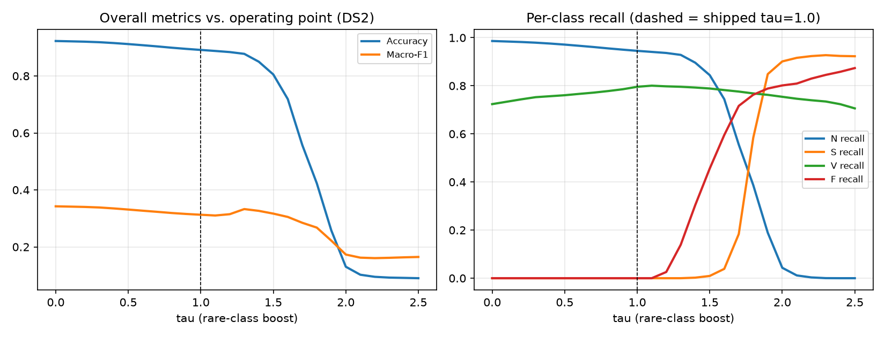
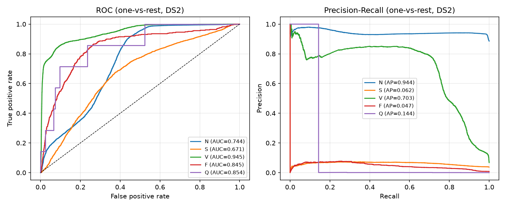
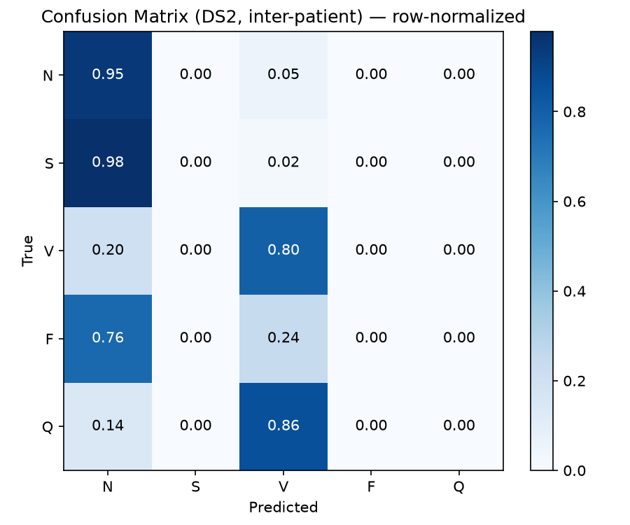

# ECG Visibility-Graph GCN

Classify MIT-BIH heartbeats (AAMI 5-class: N/S/V/F/Q) by converting each
beat's waveform into a **visibility graph** and classifying it with a
**Graph Convolutional Network**, rather than treating it as raw-signal
time-series classification.

See `prd.md` (parent directory) for full design rationale.

## Pipeline

```
ingestion.py  ->  preprocessing.py  ->  visibility_graph.py  ->  dataset.py  ->  train.py  ->  evaluate.py
 (wfdb pull)      (filter, segment)      (ts2vg -> PyG Data)     (cache .pt)    (GCN)        (metrics, plots)
```

## Setup

```bash
pip install -r requirements.txt
```

## Usage

```bash
# 1. Build the cached graph dataset (slow, run once; downloads MIT-BIH on first run)
python src/dataset.py --split all

# 2. Train (uses DS1 records, inter-patient split with a held-out val fraction)
python src/train.py --epochs 100 --batch-size 128

# 3. Evaluate on DS2 (held-out patients)
python src/evaluate.py --checkpoint outputs/checkpoints/best_model.pt
```

Or run `notebooks/colab_training.ipynb` on a free-tier Colab/Kaggle GPU.

## Repository structure

```
data/            raw PhysioNet downloads + cached PyG graph datasets (gitignored)
src/             pipeline stages (see above)
notebooks/       Colab GPU training entry point
outputs/         checkpoints, figures, metrics reports (gitignored)
```

## Features

- **Visibility-graph representation** — each beat becomes a Natural Visibility Graph (200 nodes, `[amplitude, time]` features).
- **Selectable GNN backbone** — `--arch gcn|sage|gat`, `--pooling mean|meanmax` (default: original 3-layer GCN + mean pooling).
- **Calibrated 3-model ensemble** (GCN+SAGE+GAT, `python src/train_ensemble.py`), temperature-scaled; `python src/tune_operating_point.py` picks the threshold on held-out patients.
- **PDF report** with advice, uncertainty and saliency (`python src/report.py img.png`; also in the app).
- **Class-balanced oversampling** and inter-patient DS1/DS2 split (no patient leakage).
- **Rich evaluation** — per-class sensitivity/specificity, ROC + PR curves, balanced accuracy, MCC, macro-AUROC, normalized confusion matrix.
- **Training curves** — `training_history.json` + `training_curves.png` written after every run.
- **Explainability** — gradient x input node saliency shows which part of the beat drove the prediction (`src/explain.py`).
- **Uncertainty** — Monte-Carlo dropout gives per-class std and a predictive-entropy score.
- **Image input** — digitizes a photo/screenshot of a beat; Streamlit demo with bundled samples, saliency, graph stats and JSON report download.
- **Batch CLI** — `python src/predict.py samples/ --csv out.csv`.
- **Tests** — `python -m pytest tests`.

## Results (DS2, inter-patient, 5-class AAMI)

Model: calibrated ensemble of GCN + GraphSAGE + GATv2 (mean+max readout, per-beat z-scored amplitude,
degree features), trained on DS1 with a *patient-wise* validation split. Temperature scaling and the
decision threshold (logit adjustment, `tau=1.0`) were fitted on held-out DS1 patients only; DS2 was
never used for selection. 47,426 held-out beats from 22 unseen patients.

| Metric | Original single GCN | Calibrated ensemble |
|---|---|---|
| Accuracy | 0.563 | **0.891** |
| MCC | 0.307 | **0.462** |
| Macro-AUROC | 0.732 | **0.812** |
| Macro-F1 | 0.302 | 0.313 |
| Balanced accuracy | **0.581** | 0.348 |
| N / V F1 | 0.698 / 0.503 | **0.941 / 0.624** |
| S / F / Q recall | 0.87 / 0.68 / 0.14 | 0 / 0 / 0 |

**Honest reading.** The ensemble is much better on the classes a single beat can express (N and V:
V precision 0.40 to 0.51, F1 0.50 to 0.62) and is better calibrated (validation NLL 0.50 to 0.36).
But it no longer flags S, F or Q at the default setting. The original model's high S/F "recall" came with
0.14 / 0.04 precision, i.e. it was flagging almost everything. Supraventricular beats are mostly identified by
*when* they arrive (RR interval), and fusion beats look like a blend of N and V, so a single isolated beat
carries little evidence for them (S AUROC 0.67). The app's **Detection sensitivity** slider trades overall
accuracy for rare-class recall (see the curve below; e.g. `tau=1.5` recovers F recall ~0.46 while N recall drops
to ~0.84). Feature variants (z-scored amplitude, slope/curvature) were tried and made no meaningful difference
on validation patients, so the remaining limit is the single-beat input, not the feature set.
Adding RR-interval context from the surrounding recording is the most promising next step.






## Demo

```bash
streamlit run app.py
```

## Status

Full MIT-BIH graph dataset built; model trained and evaluated on DS2 (see Results).
This is a research/demo project, **not a diagnostic tool**.
