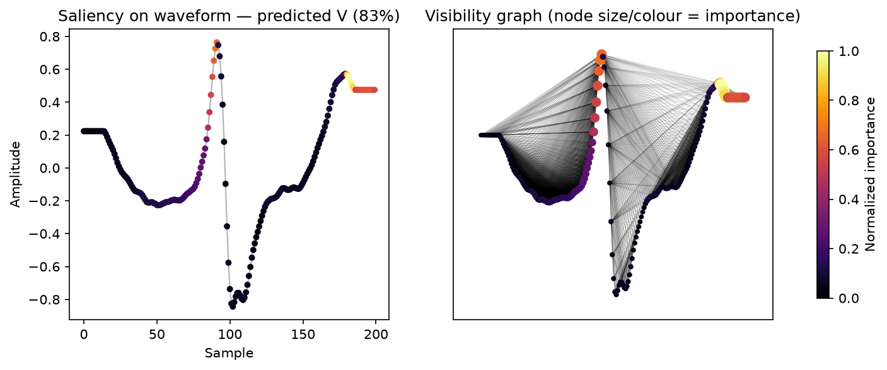

# ECG Visibility-Graph GCN

Classify MIT-BIH heartbeats (AAMI 5-class: N/S/V/F/Q) by converting each
beat's waveform into a **visibility graph** and classifying it with a
**Graph Convolutional Network**, rather than treating it as raw-signal
time-series classification.

See `prd.md` (parent directory) for full design rationale.

## Pipeline

```
ingestion.py  ->  preprocessing.py  ->  visibility_graph.py  ->  dataset.py  ->  train.py  ->  evaluate.py
 (wfdb pull)      (filter, segment)      (ts2vg -> PyG Data)     (cache .pt)    (GCN)        (metrics, plots)
```

## Setup

```bash
pip install -r requirements.txt
```

## Usage

```bash
# 1. Build the cached graph dataset (slow, run once; downloads MIT-BIH on first run)
python src/dataset.py --split all

# 2. Train (uses DS1 records, inter-patient split with a held-out val fraction)
python src/train.py --epochs 100 --batch-size 128

# 3. Evaluate on DS2 (held-out patients)
python src/evaluate.py --checkpoint outputs/checkpoints/best_model.pt
```

Or run `notebooks/colab_training.ipynb` on a free-tier Colab/Kaggle GPU.

## Repository structure

```
data/            raw PhysioNet downloads + cached PyG graph datasets (gitignored)
src/             pipeline stages (see above)
notebooks/       Colab GPU training entry point
outputs/         checkpoints, figures, metrics reports (gitignored)
```

## Features

- **Visibility-graph representation** — each beat becomes a Natural Visibility Graph (200 nodes, `[amplitude, time]` features).
- **Selectable GNN backbone** — `--arch gcn|sage|gat`, `--pooling mean|meanmax` (default: original 3-layer GCN + mean pooling).
- **Class-balanced oversampling** and inter-patient DS1/DS2 split (no patient leakage).
- **Rich evaluation** — per-class sensitivity/specificity, ROC + PR curves, balanced accuracy, MCC, macro-AUROC, normalized confusion matrix.
- **Training curves** — `training_history.json` + `training_curves.png` written after every run.
- **Explainability** — gradient x input node saliency shows which part of the beat drove the prediction (`src/explain.py`).
- **Uncertainty** — Monte-Carlo dropout gives per-class std and a predictive-entropy score.
- **Image input** — digitizes a photo/screenshot of a beat; Streamlit demo with bundled samples, saliency, graph stats and JSON report download.
- **Batch CLI** — `python src/predict.py samples/ --csv out.csv`.
- **Tests** — `python -m pytest tests`.

## Results (DS2, inter-patient, 5-class AAMI)

Checkpoint from a short training run (not tuned to convergence). 47,426 held-out beats.

| Metric | Value |
|---|---|
| Accuracy | 0.563 |
| Balanced accuracy | 0.581 |
| Macro-F1 | 0.302 |
| Weighted-F1 | 0.662 |
| MCC | 0.307 |
| Macro-AUROC | 0.732 |

| Class | Sensitivity | Specificity | AUROC | F1 |
|---|---|---|---|---|
| N | 0.541 | 0.943 | 0.879 | 0.698 |
| S | 0.874 | 0.780 | 0.833 | 0.235 |
| V | 0.669 | 0.928 | 0.929 | 0.503 |
| F | 0.675 | 0.860 | 0.774 | 0.072 |
| Q | 0.143 | 0.988 | 0.247 | 0.004 |

**Honest reading:** the model separates V (ventricular) beats reasonably well (AUROC 0.93), but
oversampling pushes it to over-predict rare classes, so S/F precision is very low and N recall is only
0.54. Class Q has just 7 test beats, so its numbers are not meaningful. Longer training, threshold
calibration, and trying `--arch gat --pooling meanmax` are the obvious next steps.




## Demo

```bash
streamlit run app.py
```

## Status

Full MIT-BIH graph dataset built; model trained and evaluated on DS2 (see Results).
This is a research/demo project, **not a diagnostic tool**.
